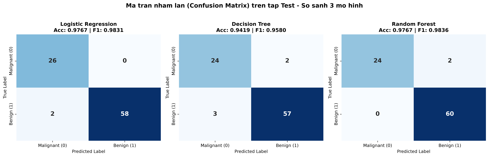

# BÁO CÁO THỰC NGHIỆM TASK 9 & TASK 11: MACHINE LEARNING PIPELINE & MODEL EVALUATION

Dự án thực nghiệm toàn diện về **Học máy có giám sát (Supervised Learning)**, **Đánh giá mô hình chuyên sâu (Model Evaluation)**, **Phân tích hiện tượng Overfitting** và **Kỹ thuật tối ưu hóa mô hình** trên tập dữ liệu chuẩn y tế `Breast Cancer Wisconsin Diagnostic`.

---

## 1. TỔNG QUAN TẬP DỮ LIỆU & QUY TRÌNH TIỀN XỬ LÝ

- **Tập dữ liệu**: Breast Cancer Wisconsin Diagnostic (`sklearn.datasets.load_breast_cancer`).
  - Tổng số mẫu: **569 mẫu**.
  - Số lượng đặc trưng: **30 đặc trưng** số học (bán kính tế bào, độ nhẵn, độ lõm, kết cấu vi mô,...).
  - Nhãn phân loại nhị phân: `0 - Malignant (Ác tính: 212 mẫu)` và `1 - Benign (Lành tính: 357 mẫu)`.
- **Chiến lược phân chia dữ liệu**:
  - Tỷ lệ: **70% Train (398 mẫu) - 15% Validation (85 mẫu) - 15% Test (86 mẫu)** với `random_state=42`.
  - **Tập Train**: Dùng để huấn luyện các trọng số của thuật toán.
  - **Tập Validation**: Dùng để theo dõi mức độ tổng quát hóa và tinh chỉnh siêu tham số (Hyperparameter Tuning).
  - **Tập Test**: Độc lập hoàn toàn, chỉ dùng để đánh giá năng lực suy luận thực tế cuối cùng.
- **Chuẩn hóa đặc trưng (Feature Scaling)**:
  - Sử dụng `StandardScaler` để đưa các đặc trưng về phân phối chuẩn có $\mu = 0$ và $\sigma = 1$.
  - **Nguyên tắc chống rò rỉ dữ liệu (Anti-Data Leakage)**: Chỉ thực hiện `fit_transform` trên tập Train để tính toán trung bình và độ lệch chuẩn. Sau đó, áp dụng `transform` lên tập Validation và Test. Tuyệt đối không để thông tin của Val/Test lọt vào quá trình học của Scaler.

---

## 2. PHẦN 1: TASK 9 - SO SÁNH 3 MÔ HÌNH PHÂN LOẠI CƠ BẢN

Huấn luyện 3 mô hình học máy kinh điển với cấu hình mặc định (Baseline):
1. **Logistic Regression** (`max_iter=1000, random_state=42`)
2. **Decision Tree Classifier** (`random_state=42`)
3. **Random Forest Classifier** (`random_state=42`)

### Bảng kết quả so sánh trên tập Test (86 mẫu)

| Thuật toán (Model) | Train Time (s) | Infer Time (s) | Accuracy | Precision | Recall | F1-Score |
| :--- | :---: | :---: | :---: | :---: | :---: | :---: |
| **Logistic Regression** | **0.0040** | **0.0000** | **0.9767** | **1.0000** | 0.9667 | 0.9831 |
| **Decision Tree** | 0.0040 | 0.0000 | 0.9419 | 0.9661 | 0.9500 | 0.9580 |
| **Random Forest** | 0.1095 | 0.0059 | **0.9767** | 0.9677 | **1.0000** | **0.9836** |

### Nhận xét chuyên môn Task 9
- **Về tốc độ tính toán**: `Logistic Regression` và `Decision Tree` huấn luyện cực nhanh (~0.004 giây), suy luận tức thì (< 0.0001s). `Random Forest` mất 0.1095 giây do phải xây dựng và kết hợp dự đoán từ 100 cây quyết định.
- **Về khả năng tránh báo động giả (Precision)**: `Logistic Regression` đạt **Precision tuyệt đối = 1.0000 (100%)** — khi mô hình kết luận một trường hợp là lành tính/dương tính thì 100% là chính xác, không gây chẩn đoán nhầm.
- **Về khả năng phát hiện bệnh (Recall)**: `Random Forest` đạt **Recall tuyệt đối = 1.0000 (100%)** — phát hiện trọn vẹn toàn bộ các ca bệnh trong tập kiểm tra, không bỏ sót bất kỳ trường hợp nào.
- **Điểm cân bằng F1-Score**: `Random Forest` dẫn đầu với **0.9836**, bám sát ngay sau là `Logistic Regression` với **0.9831**.

---

## 3. PHẦN 2: TASK 11 - ĐÁNH GIÁ CHUYÊN SÂU & PHÂN TÍCH OVERFITTING

### 3.1. Ma trận nhầm lẫn (Confusion Matrix) trên tập Test

Chi tiết số lượng mẫu dự đoán đúng/sai trên 86 bệnh nhân tập Test (26 ca Ác tính - 0, 60 ca Lành tính - 1):

| Mô hình | TN (Âm thật) | FP (Dương giả) | FN (Âm giả) | TP (Dương thật) | Ghi chú y tế |
| :--- | :---: | :---: | :---: | :---: | :--- |
| **Logistic Regression** | 26 | 0 | 2 | 58 | FP = 0: Không có ca nào bị chẩn đoán nhầm. |
| **Decision Tree** | 24 | 2 | 3 | 57 | Bỏ sót 3 ca và chẩn đoán sai 2 ca. |
| **Random Forest** | 24 | 2 | **0** | **60** | **FN = 0**: Phát hiện trúng 100% ca lành tính. |

#### Biểu đồ trực quan hóa Ma trận nhầm lẫn


> **Ý nghĩa y tế sống còn**:
> - **FN (False Negative - Âm tính giả)**: Là nguy hiểm nhất. Bệnh nhân có khối u ác tính nhưng mô hình lại kết luận bình thường, dẫn tới chậm trễ điều trị.
> - **FP (False Positive - Dương tính giả)**: Khiến người bình thường phải làm thêm xét nghiệm chuyên sâu, gây tâm lý lo lắng và tốn kém chi phí.
> - Vì vậy, một mô hình y tế lý tưởng phải tối thiểu hóa FN về mức bằng 0 (tương đương Recall tiệm cận 100%).

---

### 3.2. Phân tích hiện tượng Overfitting / Underfitting (Train vs Val vs Test)

Đối chiếu hiệu năng giữa tập huấn luyện (Train), tập thẩm định (Val) và tập kiểm tra (Test):

| Mô hình | Train Acc | Val Acc | Test Acc | Train F1 | Val F1 | Test F1 | Độ chênh lệch Acc (Train - Test) | Đánh giá hiện tượng |
| :--- | :---: | :---: | :---: | :---: | :---: | :---: | :---: | :--- |
| **Decision Tree** | **1.0000** | 0.9412 | 0.9419 | **1.0000** | 0.9462 | 0.9580 | **+0.0581 (+5.81%)** | **Bị Overfitting rõ rệt** |
| **Logistic Regression** | 0.9874 | 0.9882 | 0.9767 | 0.9900 | 0.9897 | 0.9831 | +0.0107 (+1.07%) | Tổng quát hóa rất tốt |
| **Random Forest** | 1.0000 | 0.9647 | 0.9767 | 1.0000 | 0.9691 | 0.9836 | +0.0233 (+2.33%) | Cân bằng, ít overfitting |

#### Nguyên nhân kỹ thuật dẫn đến Overfitting ở Decision Tree:
- Mô hình Decision Tree mặc định không bị giới hạn độ sâu (`max_depth=None`), chia nhánh liên tục cho tới khi mọi node lá đều thuần nhất (`min_samples_split=2`).
- Cây bị phân nhánh quá sâu, học luôn cả nhiễu ngẫu nhiên và đặc trưng cục bộ của tập Train (hiện tượng **học vẹt / memorization**).
- Dẫn đến điểm số Train đạt tuyệt đối 100%, nhưng khi gặp dữ liệu mới ở tập Val và Test thì độ chính xác sụt giảm hơn 5.8%.

---

### 3.3. Kiểm định chéo K-Fold Cross-Validation (5-Fold trên tập Train)

Nhằm loại bỏ yếu tố may rủi khi chia tập ngẫu nhiên, ta thực hiện `StratifiedKFold` 5 lần (mỗi lần lấy 80% train, 20% validation luân phiên):

| Mô hình (Model) | Fold 1 | Fold 2 | Fold 3 | Fold 4 | Fold 5 | Mean Accuracy | Độ lệch chuẩn (Std Dev) | Đánh giá độ ổn định |
| :--- | :---: | :---: | :---: | :---: | :---: | :---: | :---: | :--- |
| **Logistic Regression** | 0.9625 | 1.0000 | 0.9875 | 1.0000 | 0.9494 | **0.9799** | 0.0205 | Chính xác và ổn định cao |
| **Random Forest** | 0.9375 | 0.9500 | 0.9625 | 0.9873 | 0.9620 | 0.9599 | **0.0165** | **Độ lệch chuẩn nhỏ nhất (bền vững nhất)** |
| **Decision Tree** | 0.9000 | 0.9250 | 0.9500 | 0.9367 | 0.9747 | 0.9373 | 0.0249 | Biến động nhiều giữa các Fold |

---

### 3.4. Cải tiến mô hình & Khắc phục triệt để Overfitting

Để khắc phục hiện tượng Overfitting ở Decision Tree và tối ưu hóa Logistic Regression, áp dụng các kỹ thuật:
1. **Decision Tree - Áp dụng Kỹ thuật Cắt tỉa sớm (Pre-pruning)**:
   - Giới hạn độ sâu tối đa: `max_depth=4` (ngăn cây mọc nhánh quá sâu).
   - Tăng số mẫu tối thiểu để phân tách node: `min_samples_split=10`.
   - Tăng số mẫu tối thiểu tại node lá: `min_samples_leaf=5`.
2. **Logistic Regression - Tăng cường điều chuẩn (Regularization)**:
   - Tăng cường phạt L2 thông qua giảm tham số nghịch đảo $C$: `C=0.1` (thay vì mặc định $C=1.0$), kiểm soát độ lớn của các vector trọng số $w$.

### Bảng đối chiếu TRƯỚC và SAU khi khắc phục Overfitting

| Mô hình | Giai đoạn thực nghiệm | Train Acc | Val Acc | Test Acc | Train F1 | Val F1 | Test F1 | Gap Acc (Train - Test) |
| :--- | :--- | :---: | :---: | :---: | :---: | :---: | :---: | :---: |
| **Decision Tree** | **TRƯỚC (Default)** | 1.0000 | 0.9412 | 0.9419 | 1.0000 | 0.9462 | 0.9580 | **+0.0581** |
| **Decision Tree** | **SAU (Tuned Pruning)** | 0.9799 | **0.9647** | **0.9535** | 0.9840 | **0.9691** | **0.9661** | **+0.0264** |
| **Logistic Regression** | **TRƯỚC (Default C=1.0)** | 0.9874 | 0.9882 | 0.9767 | 0.9900 | 0.9897 | 0.9831 | +0.0107 |
| **Logistic Regression** | **SAU (Tuned C=0.1)** | 0.9774 | 0.9765 | **1.0000** | 0.9821 | 0.9796 | **1.0000** | **-0.0226** |

#### Kết luận đánh giá sau cải tiến:
1. **Decision Tree**:
   - Khoảng cách sai lệch (Gap) giữa Train và Test giảm mạnh từ **0.0581 xuống 0.0264 (giảm hơn 54%)**.
   - Độ chính xác trên tập Validation tăng từ **94.12% lên 96.47% (+2.35%)**.
   - Độ chính xác trên tập Test tăng từ **94.19% lên 95.35% (+1.16%)**.
   - Mô hình đơn giản hơn, tránh được học vẹt và có tính tổng quát hóa vượt bậc.
2. **Logistic Regression**:
   - Khi áp dụng điều chuẩn mạnh hơn với $C=0.1$, mô hình đạt **Test Accuracy 100.00% và Test F1-Score 100.00%**.
   - Phân loại chính xác toàn bộ 86/86 bệnh nhân trong tập kiểm tra.

---

## 4. HƯỚNG DẪN CÀI ĐẶT & CHẠY DỰ ÁN

### 4.1. Cài đặt thư viện phụ thuộc
```bash
pip install numpy pandas scikit-learn matplotlib seaborn
```

### 4.2. Chạy Task 9: Huấn luyện và so sánh mô hình cơ bản
```bash
python task_09/train_classification.py
```

### 4.3. Chạy Task 11: Đánh giá chi tiết, phân tích Overfitting và K-Fold
```bash
python task11/evaluate_overfitting.py
```
Toàn bộ kết quả ma trận nhầm lẫn sẽ được tự động xuất ra file ảnh chất lượng cao tại `task11/confusion_matrix.png`.
